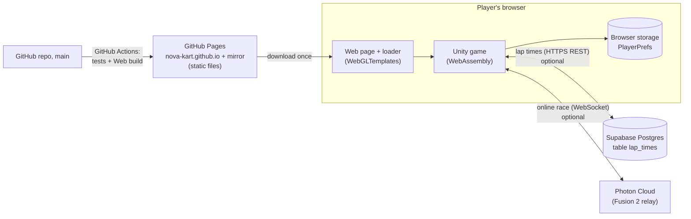

# Architecture: how Carcavelos Circuit is built, and why

This page is for someone who has never opened the project. It explains the parts, how data flows between them, and why each big choice was made. Limits and what we would change are in [limits-and-next-steps.md](limits-and-next-steps.md); short answers for the walkthrough are in [walkthrough-qa.md](walkthrough-qa.md).

## The big picture

The game is a Unity project compiled to WebAssembly and served as static files from GitHub Pages, at two addresses that carry the same build (see Build and deploy). It has no server of its own. Two hosted services are used, and both are optional: the game keeps working without them.

| Part | What it does | Where it lives |
|---|---|---|
| Web page | Loading screen, error cards ("The game could not start", "needs WebGL 2"), touch buttons on phones, fullscreen, update check | `Assets/WebGLTemplates/CarcavelosCircuit/index.html` |
| Game | Everything you see and drive: menus, race, bots, items, HUD, sound | `Assets/_Project/` (one folder per module, below) |
| Browser storage | Best times, ghost, settings, chosen mode and driver, a copy of every saved time (the offline fallback) | Unity `PlayerPrefs` (the browser's IndexedDB) |
| Supabase | The global top 10 shared by all players (one table); a daily GitHub Actions read keeps the free project awake (`.github/workflows/leaderboard-keepalive.yml`) | Schema and rules: `backend/supabase/` |
| Photon Cloud | Relays the online race between players (no data stored) | Code: `Assets/_Project/Online/Fusion/` |
| GitHub Actions | Runs the tests, builds the Web version, deploys `main` | `.github/workflows/` |

## Modules: one folder, one owner, one assembly

Every module is a folder under `Assets/_Project/` with its own assembly definition (`.asmdef`), so Unity refuses to compile a reference that is not allowed. Modules talk only through small interfaces in `Shared/` (the contracts in [interfaces.md](interfaces.md)).

| Module | Owner | What it holds |
|---|---|---|
| `Shared/` | Role 4 | The contracts: `IKartState`, `IKartBoost`, `IKartDrivable`, `IRacer`, `ITrackProgress`, `RacerRegistry`; time of day |
| `Driving/` | Role 1 | `KartController` (physics, drift, boost, jump, trick, recover), `KartTuning` numbers, input, the Cinemachine chase camera prefab, name tags above karts |
| `Track/` | Role 2 | `TrackInfo`, `Checkpoint`, `SpawnPoint`, `RaceRules` (lap validation), `TrackProgress` (how far along the lap), guardrails, piano |
| `Visuals/` | Role 3 | The campus world (`CampusWorld/`, generated by `tools/world_gen/`), kart and driver models, effects, five bots (`Bots/`), item looks (`ItemFx/`) |
| `RaceFlow/` | Role 4 | The game around the track: boot, race state machine, timer, menus and HUD (`UI/`), items, ghost, medals, leaderboard (`Leaderboard/`), positions, minimap, kart builder, Web build script (`Editor/Role4WebBuild.cs`) |
| `Audio/` | Role 4 | Engine, drift and boost sounds, music mixing maths |
| `Ambience/` | Role 4 | Waves rolling onto the beach and surfers riding them |
| `Online/` | Role 4 | Online race: lobby, room rules, pose sending, race control, all behind `IOnlineSession` |
| `Online/Fusion/` | Role 4 | The Photon Fusion 2 implementation of `IOnlineSession` (compiled only when the Photon SDK is present) |
| `Tests/` | everyone | Edit Mode and Play Mode tests (see [verification.md](verification.md)) |

References point one way (read from the `.asmdef` files): `Driving`, `Track`, `Audio`, `Ambience` -> `Shared`; `RaceFlow` -> `Shared`, `Track`, `Audio`; `Visuals` -> `Shared`, `Track`, `RaceFlow` (the bots read the race roster, decision 2026-11-13); `Online` -> `Shared`, `Track`, `RaceFlow`, `Visuals`; `Online.Fusion` -> `Online`, `Shared`, `RaceFlow` + the Photon SDK. No cycles: the race code never knows the bots, the bots read the race. Details at the top of [interfaces.md](interfaces.md).

**Why:** four people pushed into one repo every day for three weeks. Unity scenes merge badly, so every role owns its own folder and scene, and `Main.unity` is rebuilt by code (Carcavelos Circuit > Build Role 4 Scenes) instead of by hand. The contracts let each role build against placeholders on day one without waiting for the others, and let a bot drive the same kart as the player.

## What happens when you open the link

1. **Page.** `index.html` checks WebGL 2 and WebAssembly (clear error card if missing), asks `version.json` whether a newer build exists (so nobody plays a cached old one), shows the loading bar and downloads the game code and menus (about half of the 50 MB). The game then starts, and `RaceFlow/WorldStream.cs` downloads the campus world as its own file `Build/world-<content hash>.bundle` (the other half; the page picks the DXT or the ETC2 phone version) while the same loading bar goes on. The world file is cached in the browser for good (its name changes only when the world changes), so a deploy that did not touch the world does not download it again ([history/2026-11-18-load-time.md](history/2026-11-18-load-time.md)). "Click to play" waits until the track is ready. If the world fails twice (one quiet retry), the page shows "The track did not download" with Reload the page.
2. **Boot.** `Main.unity` starts `RaceFlow/RaceBootstrap.cs`. It first waits for `WorldStream.Load()` (in the Editor, in tests and in a build with the world inside the `.data` there is no world file and this does nothing; if the download failed it stops here and never falls back to the test loop), then loads the first track scene in the `RaceSettings` list that contains a `TrackInfo` (today: `Visuals/Scenes/Track_CampusWorld.unity`, the campus built from Noah's route), places the karts on the grid and hands everything to `RaceManager`.
3. **Start screen.** Three modes (`RaceModeRules`): Race vs Bots, Time Attack, Online Race. Kart builder: driver, kart and tyres (Luc's four of each, 64 looks-only sets built at run time by `Visuals/Kart/KartAssembler`). Settings, credits, the leaderboard.
4. **Race.** `RaceStateMachine`: Ready -> Countdown -> Racing -> Results. Input is on only while Racing. Each checkpoint crossing goes through `RaceRules`, so a lap only counts if every checkpoint was crossed in order (skipped, doubled or backwards crossings are refused). `RaceTimer` counts; R recovers to the last valid checkpoint; Enter retries.
5. **Around the race.** Bots (`Visuals/Bots/`) drive the same `Kart.prefab` as the player through `IKartDrivable`, deciding with plain maths in `BotRules`. Item boxes (`RaceFlow/ItemSystem.cs`) give one of four items, better ones when you are behind your best lap (`ItemOdds`). Positions, minimap and name tags read `RacerRegistry` and `ITrackProgress`. The ghost replays your best lap.
6. **Finish.** Finish cinematic, place or lap time, medal, then the results card. In Time Attack you can save the time with a name: the name and time are checked in the game (`PlayerNameRules`, `LapTimeRules`), saved on the device first, then sent online.

## Where the data lives

| Data | Stored where | Who can read or change it |
|---|---|---|
| Best lap per track, ghost of the best lap, settings, last mode, driver, player name, which coach tips were shown | `PlayerPrefs` in the player's browser | Only that browser. Clearing site data removes it |
| Device copy of every saved time (fallback when offline) | `PlayerPrefs` (`CarcavelosCircuit.Leaderboard.*`) | Only that browser |
| Global leaderboard | Supabase table `lap_times` (name, seconds, track, created_at) | Public key may only SELECT and INSERT; Row Level Security and CHECK rules in `backend/supabase/001_lap_times.sql`; no UPDATE or DELETE |
| Online race state (names, driver, pose, finish) | In memory in each player's game, relayed by Photon | Nothing is stored; it is gone when the room empties |
| Keys (Photon App ID, Supabase URL + public key, Unity licence) | GitHub Actions secrets only | Written into the build at build time, never committed |

No accounts, no passwords, no emails: a player is only a name they type.

## Online race in one paragraph

Photon Fusion 2 in Shared Mode. Every player's game drives its own kart exactly as offline and sends its pose 15 times a second; the other karts are drawn as proxies 0.22 s in the past and blended between poses (`Online/Pose/`). The first player in the room is the host and presses START; every client counts down to the same shared start time; the finish order is the reported lap times, sorted the same way on every screen (`Online/Race/`). One room for the class, 15 players. Details and the scale test results: [online.md](online.md).

**Why the Photon code sits behind an interface:** Photon's licence forbids putting its SDK into a public repo. So `Online/` contains all the rules and talks to an `IOnlineSession` interface; `Online/Fusion/` is compiled only when CI has fetched the SDK from a private repo. A fresh clone compiles and plays single player, and the online rules are still tested, with a loopback session and a browser-tab transport (`?net=local`) instead of Photon.

## Build and deploy

| Step | How |
|---|---|
| Tests | `.github/workflows/tests.yml`: GameCI runs every Edit Mode and Play Mode test in Unity on Linux, on every pull request into `main` and every push to `main` ([verification.md](verification.md)) |
| Security checks | `.github/workflows/security.yml`: a secret scan over every commit of every branch, and a check that every action, Unity package and Python tool is pinned to an exact version ([security.md](security.md)) |
| Leaderboard keep-alive | `.github/workflows/leaderboard-keepalive.yml`: one read a day, so the free Supabase project never pauses |
| Web build | `.github/workflows/web-build.yml` on every push to `main`: fetches the Photon SDK (read-only deploy key), runs `Role4WebBuild.Build`, which sets every Web setting in code (compression, texture and mesh budgets, ETC2 for phones, the keys from secrets), builds the campus world as its own AssetBundle (DXT + ETC2) next to the player build and stamps the world file names into `index.html` (`-worldInData` builds the old way, world inside the `.data`) |
| Deploy | The same workflow publishes the build to this repository's GitHub Pages site; the `github-pages` environment only accepts `main` |
| Public link | The workflow's `mirror` job copies the same build files to the repository `nova-kart/nova-kart.github.io` (GitHub organisation `nova-kart`), which GitHub serves at the short public link. That repository holds only the built files, replaced by one fresh commit per deploy through a deploy key that can write only to that one repository (secret `NOVA_KART_DEPLOY_KEY`); without the key the mirror step is skipped and the other address still updates |

**Two addresses, one build.** The README's link (`nova-kart.github.io`) is short and carries no personal account name, so it is the one we share. The longer address under this repository keeps working, because it is the same files from the same `main` build. The code did not move: history, pull requests and CI stay in `github.com/belschak/carcavelos-circuit`, and the organisation only serves the public link. Moving the whole repository would have broken the old Pages address (GitHub does not redirect Pages URLs) a few days before submission; a mirror keeps both working.

So the code on `main` is the code that is deployed, and nobody deploys from a laptop.

## Why these choices

| Choice | Why | What it costs |
|---|---|---|
| **Unity (C#) instead of the course's Python + Streamlit** | The product is a 3D racing game: 60 frames a second, physics, a camera, a 3D campus. The product needs 3D physics, real-time play between 15 users and phone controls, exactly the cases the course's stack guide lists as Streamlit's weak spots. Unity gives physics, a scene editor, Cinemachine, a Web export and NUnit tests. The stack was approved by the teaching staff (18.11.2026); details in "Stack approval" below | A different language and test tool from the course; about 50 MB download; Unity licence needed in CI |
| **Rule-based bots, no machine learning** | Every decision is a few lines of maths (`BotRules`: pure-pursuit steering, braking before bends, stuck check) that any member can explain and Edit Mode tests can check. Bots use the player's kart physics, so they are fair and can be bumped | Bots do not learn; they follow the racing line and a light rubber band |
| **Items with campus names** (Espresso, Seagull Delivery, Carcavelos Wave, Dean's List) | Arcade feel and a reason to drive through the boxes. Odds favour the player who is behind | Bots do not use items (yet) |
| **Supabase for the leaderboard** | Free hosted Postgres with a REST API, so no server of ours. Row Level Security makes a public key safe: it can only read and add rows that pass the CHECK rules | A free project pauses after a week without requests; a script can post fake but valid times (limits page) |
| **Device first, online second** | The game must keep working when the internet or Supabase is down (course rule "It works"). Every time is saved locally first | Device times stay on that browser |
| **Photon Fusion 2 (Shared Mode)** | A browser cannot host a game server, and we run no servers. Photon recommends Shared Mode for WebGL (direct WebSocket to its cloud); the free plan allows 100 players at once, enough for a class | Depends on a third-party cloud; SDK cannot be in the repo |
| **GitHub Pages** | Free, the same repo, deploys only from `main`, HTTPS, gzips files on the fly. Replaced the first idea (itch.io) so the URL stays fixed and `main` equals what is live | Static only; a Pages URL does not redirect if the repo moves |
| **Settings in code** (`Role4WebBuild`, `ProjectSetup`, scene builders) | Reproducible: CI and every laptop get the same build; no hand-clicked setting gets lost in a merge | More C# to read; the build script is long |
| **World generated from data** (`tools/world_gen/`, Python + Blender) | The campus comes from OpenStreetMap, Street View and photo surveys, so it can be rebuilt and corrected instead of hand-placed | Needs Blender and the scripts to change the world; outputs are committed FBX and textures |

### Stack approval

**Why not Streamlit.** The course's stack guide names the cases where Streamlit is the wrong tool: "a custom interface, a mobile-friendly layout, or real-time interaction between users", and it says games "usually do not" suit Streamlit because it "reruns the script for each user separately, which makes shared live state difficult". Our product needs all of them at once:

| What the product needs | Where it is in the code | Why Streamlit cannot do it |
|---|---|---|
| 3D at 60 frames a second with physics (a kart, jumps, collisions) | `Driving/KartController.cs`, `Visuals/CampusWorld/` | A Streamlit page redraws after each click; it has no game loop and no physics |
| Real-time interaction between users (15 players in one live race) | `Online/` | Each Streamlit user runs a separate script; there is no shared state at 15 updates a second |
| Phone controls (touch buttons, landscape layout) | `Assets/WebGLTemplates/CarcavelosCircuit/` | Streamlit's layout is form-like; no thumb controls over a game view |
| A custom interface (menus, HUD, minimap, finish cinematic) | `RaceFlow/UI/` | Streamlit gives standard widgets, not a game interface |

**How the stack decision was handled.** The team project page allows "start a new application" of the team's own choice; the stack guide says a language other than Python is agreed with the teaching staff case by case. The team chose Unity on 6 Nov 2026 ([decisions.md](decisions.md)) and Noah asked the teaching staff for their OK on 7 Nov (task G1 in [TASKS.md](../TASKS.md)). The staff approved the Unity stack; David confirmed the approval on 18 Nov 2026 ([decisions.md](decisions.md)).

**Status:** approved by the teaching staff (18.11.2026). Requested by Noah on 7 Nov 2026 (task G1).

## Read further

- [interfaces.md](interfaces.md): every contract between modules
- [online.md](online.md): the online race in detail
- [decisions.md](decisions.md): every decision with its date and reason
- [explain/](explain/): one walkthrough per role (how each part works, why, its limits)
- `backend/supabase/README.md`: leaderboard setup and its security model
