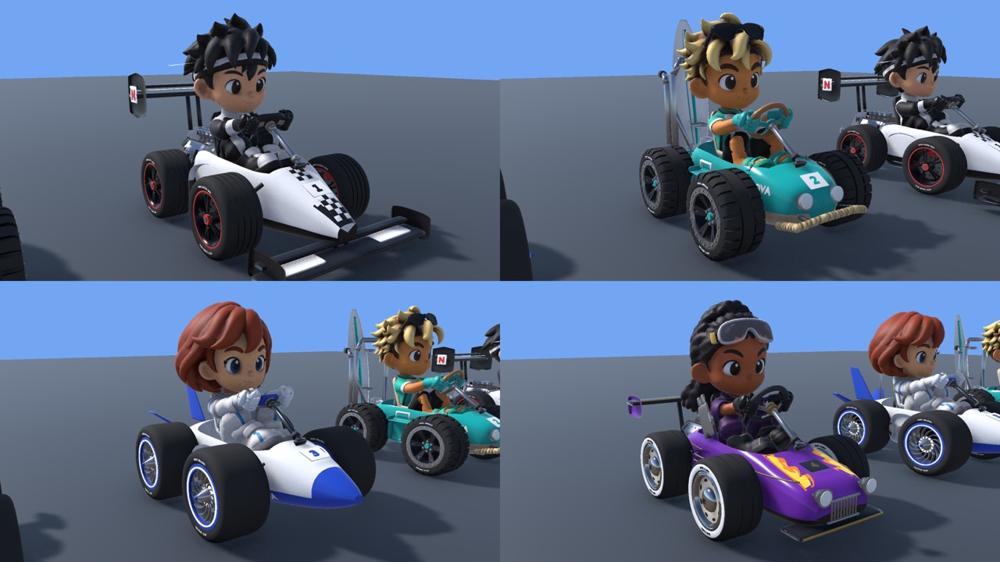
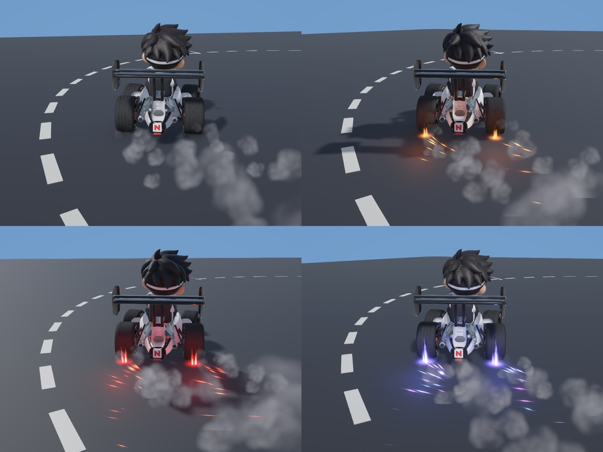

# Art status (Role 3)

Owner: Luc. Updated 2026-11-08. What exists outside the repo, what comes into Unity and when, and what Role 3 needs from the other roles.

**Why nothing is in `Assets/` yet:** the Unity project (task S1) is not on `main`, and assets only enter through the Unity Editor (`AGENTS.md`), so the `.meta` files stay right. Everything below was built and tested in a separate sandbox project (Unity 6000.6.7f1, URP 17.6). It gets imported into `Assets/_Project/Visuals/` with Unity **6000.3.28f1** as soon as S1 is merged.

## What is done (sandbox, version v12)

- **Karts (4):** Nova Classic #1 (open-wheel formula racer, black and white), Beach Buggy #2 (turquoise and sand surf buggy), Orbit #3 (white and blue mini rocket), Street GT #4 (purple and gold hot rod). All share one cockpit (seat, wheel and pedal positions), four wheel anchors and `Exhaust_*` anchors for the boost flames.
- **Drivers (4):** Rookie, Nova, Tiago, Amara, one cartoon style. Rigged; the hands stay on the steering wheel while steering (arm IK).
- **Tyre sets (4):** Slick, Offroad, Retro, Balloon. Any tyre fits any kart.
- **Drift effects:** tyre smoke, sparks, a flame behind each rear wheel and a ground glow that grow with the drift stage, plus a spark burst on every stage-up. All textures are generated by our own code (no third-party assets).
- **Boost flames** at the exhaust anchors (in progress).
- **Kart sounds** (handed to Role 4 with an audio onboarding, see Q4): engine per kart, drift squeal, spark crackle, drift start, stage-up chime. Made with ElevenLabs Sound Effects.

Scale and axes match `docs/interfaces.md`: 1 unit = 1 m, forward = +Z, pivot on the ground in the centre, tyres touch y = 0.

## What goes into the game by Fri 13 Nov

Scope is one kart (`docs/decisions.md`). Default combination: **Rookie + Nova Classic + Slick**, as the `KartVisual` prefab under `Kart/Visual`, plus `KartEffects` (V5) for drift and boost. The other karts, drivers and tyres stay in the sandbox and only come in as a stretch goal after 13 Nov (for example a second kart). Kart selection stays out of scope.

Before import:
- Textures down to **2048 px** (kart) and **1024 px** (props); the drivers are 4K today.
- Triangle count of the chosen combination checked against the web budget in `docs/art-style.md` (one combination is about 75,000 triangles today).
- Scripts moved to namespace `CarcavelosCircuit.Visuals`; effects read **only `IKartState`**, never the driving code.
- Third-party sources listed in `THIRD_PARTY.md`: Kenney Car Kit (CC0, earlier kart base), Tripo AI (driver meshes), Meshy AI (auto-rig), ChatGPT (driver concept images), ElevenLabs (sounds), Blender's bundled fonts (lettering as geometry).

## Open points for the team

These are also rows under "Requests between roles" in `TASKS.md`.

1. **Drift stages.** `IKartState.DriftStage` has 2 stages (1 blue, 2 orange). The effects have 4 looks (0 smoke, 1 orange, 2 red, 3 blue/purple). Proposal: keep the contract at 0–2 and map 0 = smoke, 1 = orange, 2 = blue/purple. Role 1 decides how many stages the drift has; Role 3 adapts the colours. `docs/art-style.md` follows whatever we pick.
2. **Steering input.** The driver turns the steering wheel and the front wheels, but `IKartState` has no steering value. Proposal: add `float Steer { get; } // -1 left .. +1 right` (contract change, team OK needed).
3. **Animation Rigging package** (Unity Registry, for the hands on the wheel). New package = Role 4 + team OK. Without it the driver still sits and steers, but the hands do not follow the wheel.
4. **Bloom.** The effects look best with a Bloom post-processing volume on the race camera (`Main.unity`, Role 4). It costs a little performance in the web build; Role 3 checks the frame rate in the S3 build.
5. **Branding.** The karts carry an "N" emblem and "NOVA" lettering on body and tyres. `docs/decisions.md` allows no Nova SBE marks until Nova Communications agrees. Proposal: swap to a "CC" mark for the shipped kart unless we get a yes.
