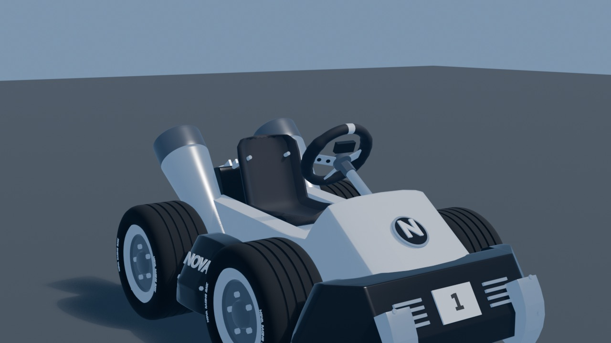

# Art style

Owner: Role 3 (Luc). Read this before you model, colour or light anything that ends up in the game.

**The look in one sentence:** a clean, cheerful low-poly arcade racer. A white-and-black kart drives through a bright seaside campus, and blue and orange tell the player what the kart is doing.

*Reference image: the current kart (Blender render, Kenney Car Kit base, CC0). Take the chunky proportions, big tyres, gloss white body with black bumpers and side pods, and flat colours from it. The "NOVA" lettering and the "N" emblem are still open, see "Open questions" below.*

## Palette (6 colours)

Use these hex values as the URP Lit **Base Color** (sRGB). Lighter or darker steps of the same colour are fine for shading a building side or a kerb. A new hue needs a row here first.

| # | Name | Hex | Where |
|---|---|---|---|
| 1 | Kart White | `#EAEAEC` | Kart body, number plate, campus building walls (a slightly darker step for shaded sides) |
| 2 | Gloss Black | `#1D1D1F` | Kart bumpers, side pods, seat, tyres, window frames |
| 3 | Asphalt | `#55585E` | Road surface, track walls, tunnel inside |
| 4 | Sand | `#E3C48D` | Beach, promenade paving, warm details on campus |
| 5 | Atlantic Blue | `#2D8CD6` | Sea, sky tint, **drift stage 1 sparks**, wrong-way and info signs |
| 6 | Boost Orange | `#FF8A1F` | **Drift stage 2 sparks, boost flame**, route arrows, checkpoint gates, kerb stripes (with Kart White) |

Why these: white and black are already the kart, so it reads cleanly against any background. Blue and orange are the two "signal" colours and match `IKartState.DriftStage` (1 = blue sparks, 2 = orange sparks, `docs/interfaces.md`). Keep them rare in the scenery so a blue or orange flash always means "your drift is charging". Sand and blue come from the beach and the sea at Carcavelos.

Chrome and metal parts are not a separate colour. They use Kart White or Gloss Black with Metallic up and Smoothness high.

## Shape language

- **Low-poly, chunky, slightly rounded.** Big simple forms with a small bevel on the edges that catch light. No thin parts that flicker at chase-camera distance (about 6 m).
- **Exaggerated proportions.** Big tyres, a short wheelbase, a big head and hands on the driver. Readable as a silhouette before it reads as detail.
- **Flat colour, no photo textures.** Colour comes from the material, not from a texture. Small texture maps only for numbers, lettering and the driver's face. Campus photos are reference for shapes and proportions, never textures in the game (`docs/route.md`).
- **Landmarks = 3 to 4 key shapes each.** A library facade is its block, its window rhythm and its roof line, not every window frame. Someone who knows the campus should recognise it at driving speed.
- **The track talks in big shapes.** Large arrows and striped kerbs at corners, a clearly different start/finish gate, walls that look like walls.
- **Nothing that copies Nintendo.** No Mario Kart characters, item boxes, logos or signature shapes. "Inspired by arcade kart racers" only (`docs/decisions.md`).

## Light and mood

Bright late-morning sun from one side (one Directional Light), soft shadows, light-blue sky. No fog, no heavy post-processing: the web build must stay fast. The tunnel is the one place that goes darker, which makes the exit to the sea feel bright.

## Budgets

From `docs/decisions.md` (fixed): textures at most **2048 px** for the kart, **1024 px** for props, **512 px** for small props; one file under **25 MB**; no `.blend`, `.psd` or photos in the repo (sources stay in `art-source/` outside the repo).

Proposal for the web build (team to confirm): kart + driver under **30,000 triangles**, each landmark under **10,000**, the whole track under **300,000**. The current kart + driver is about 75,000 triangles and its driver textures are 4K, so both get reduced before they go into `Assets/_Project/Visuals/`.

## Units and export

1 Unity unit = 1 metre, kart forward = +Z, pivot at ground level in the centre (`docs/interfaces.md`). The exact Blender FBX export settings are recorded here after the scale test (task V2).

_FBX export settings: filled in by V2._

## Open questions (team)

1. **"NOVA" lettering and the "N" emblem on the kart.** `docs/decisions.md` allows no Nova SBE logo or real brand marks until Nova Communications agrees. Proposal: replace them with a "CC" (Carcavelos Circuit) mark and the start number until we have a yes.
2. **Triangle budget** above: OK for everyone? Role 2 needs it for the track and the landmark placement.
3. **Building colour:** Kart White for the campus buildings is a guess from memory. Check it against the walk photos (7 Nov) and adjust the shade, not the palette.
